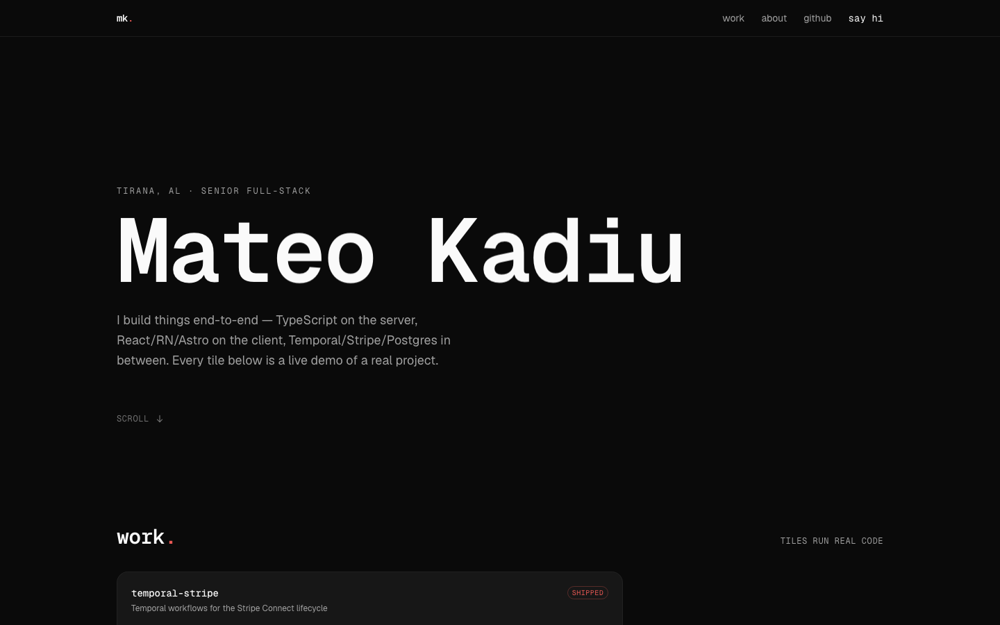
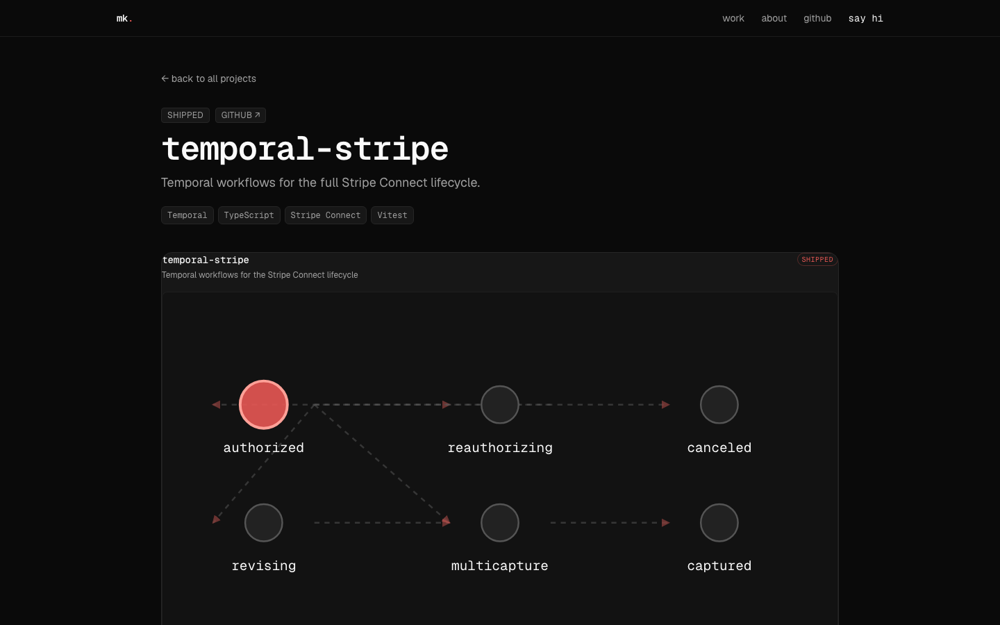
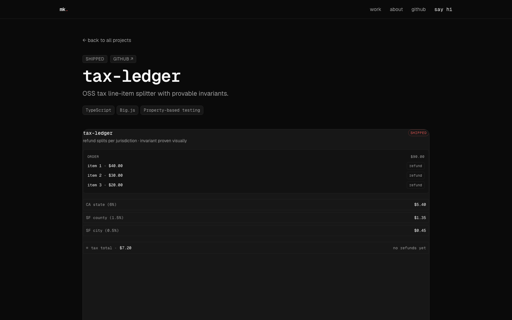

# portfolio-site

Personal portfolio at [mateokadiu.com](https://mateokadiu.com) — a bento-grid portfolio where every project tile is an interactive demo of how the real project works.

Astro (static) + Tailwind v4 + React islands. The hero and every animation are plain CSS; demos hydrate only when scrolled into view.



A click on a tile takes you to its full deep-dive page — same demo at full size, with the architecture write-up, decisions, and Q&A.




## What's in the grid

| Tile | What it is |
|---|---|
| `tide` | Capture surfaces → extract / tag / embed / summarize pipeline of the read-later app |
| `webhook-gateway-admin` | Miniature Angular admin — signal-driven counters and filter pills |
| `shadowkit` | A real `<sk-counter>` Web Component embed proving the Shadow DOM cascade boundary |
| `studybuddy` | 53×7 review heatmap — hover, tap or arrow keys to inspect a day |
| `temporal-stripe` | Stripe Connect state machine — reauth timer, multicapture, illegal-transition shake |
| `tax-ledger` | Cent-exact largest-remainder allocation, and refunds that reverse it |
| `webhook-gateway` | Retry-backoff timeline ending in the DLQ |
| `grpc-monorepo-starter` | One `.proto` fanning out to four generated clients |
| `stripe-eu-vat-moss` | EU One-Stop-Shop destination-country VAT (2026 standard rates) |
| `about`, `now`, `github`, `contact` | Utility tiles |

## Where things live

- **Projects** — `src/content/projects/*.mdx`. Frontmatter (order, tile size, blurb, demo hint, SEO) drives the grid, `/projects`, the deep-dive pages, OG cards, `llms.txt` and the tests; the body is the case study. A new project also needs its demo registered in `src/components/ProjectDemo.astro` (the build fails otherwise).
- **CV** — `src/content/cv/` (YAML, schemas in `src/content.config.ts`).
- **Identity** — name, email, links, location and job title: `SITE` / `SOCIAL` in `src/lib/data.ts`.
- **Demo logic** — pure, unit-tested modules in `src/lib/` (`ledger`, `webhook`, `heatmap`, `temporalStripeStore`).

## Scripts

```bash
pnpm install
pnpm dev                  # astro dev
pnpm build                # static export to dist/ (prebuild fetches GitHub activity + icons)
pnpm preview              # serve dist/ like Cloudflare Pages
pnpm typecheck            # astro check
pnpm lint                 # biome check
```

## QA

| Command | What it guards |
|---|---|
| `pnpm test` | Vitest unit + property tests (fast-check) for the demo logic |
| `pnpm test:e2e` | Playwright on desktop + mobile: smoke, SEO/structured-data audit, real interaction tests for every demo, axe (WCAG 2.2 AA) on every page |
| `pnpm test:visual` | Visual regression, rendered in the official Playwright Docker image so baselines match CI. After an intentional UI change: `pnpm test:visual:update` and commit `tests/__screenshots__` |
| `pnpm test:lighthouse` | Lighthouse CI: performance ≥ 0.9, accessibility / SEO = 100, best practices ≥ 0.95, LCP / CLS / TBT and a 90 KB script budget |
| `pnpm test:live` | Smoke + audit against production after a deploy |
| `pnpm qa` | Everything above (except live), in order |

E2E, visual and Lighthouse runs need a fresh `pnpm build`; visual runs need Docker. CI runs all of it on every push and pull request (`.github/workflows/ci.yml`).

## Deploy

Cloudflare Pages (free tier). Build command `pnpm build`, output `dist/`. Set a `GITHUB_TOKEN` environment variable (a fine-grained token with public read access is enough) so the GitHub tile's build-time fetch isn't rate-limited. `mateokadiu.pages.dev` 301s to the apex via a Cloudflare Bulk Redirect, and every `*.pages.dev` host (including preview deploys) is sent `X-Robots-Tag: noindex` from `public/_headers`.

## License

MIT — see [LICENSE](./LICENSE).
